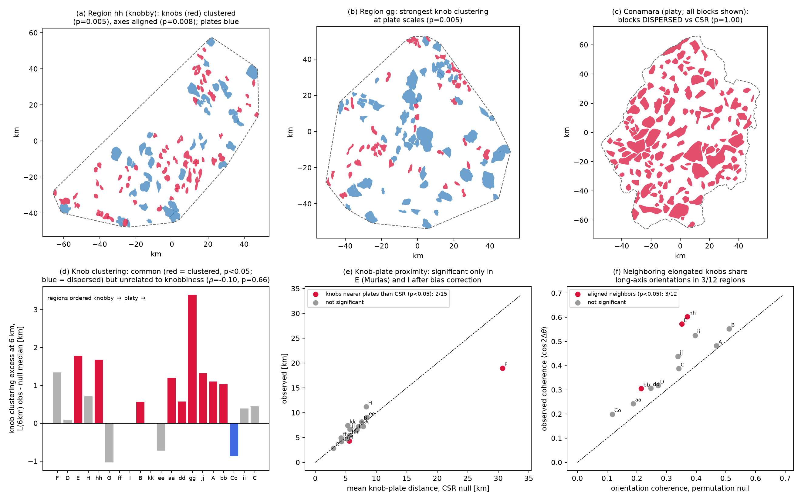

---
cursor:
  subagentId: "bc-7b8fc683-5fed-5314-917e-50b5565e397f"
---

# Is knobby chaos degraded platy chaos? First quantitative tests

**Hypothesis (C. Nixon):** knobbier chaos terrains are older, degraded
terrains that originally formed as platier chaos, with knobbiness (block
size-frequency-distribution slope) acting as an age proxy.

**Tests run (November 2026):** (1) lineament superposition density against
the USGS SIM 3513 linear-feature map; (2) spatial organization of knobs —
Ripley's K clustering at plate length scales, knob-to-plate proximity, and
orientation coherence of neighboring elongated knobs. Data: 20 block-mapped
regions (Leonard et al. 2022; Mills 2023), 2,665 unique blocks (1,104
labeled knobs, 400 plates; the four unlabeled trailing Leonard terrains use
all blocks), terrain footprints from the reconstructed Leonard outlines and
convex hulls for Mills regions. Results figure:
 Data tables:
`test1_superposition.csv`, `test2_clustering.csv`, `test2_orientation.csv`.

## Test 1 — Lineament superposition (stratigraphic age ranking)

Prediction: if knobby terrains are older, more mapped lineaments should
cross (postdate) them.

**Result: inconclusive for ranking; uniformly "young" signal.** At the
1:15,000,000 scale of SIM 3513, only 0–2 lineaments cross any of the 20
terrains (17 crossings total). Crossing density shows no correlation with
SFD slope (ρ = +0.07, p = 0.77; count version ρ = +0.21, p = 0.38;
Leonard-9 subset ρ = +0.19, p = 0.63). The informative by-product: **every
terrain, platy or knobby, has a far lower lineament density than its local
background annulus** (density ratio < 1 in all 20; median ≈ 0.07). No
terrain — including the knobbiest — has accumulated meaningful
re-tectonization since formation. This is consistent with all 20 being
young relative to the surrounding plains and mildly unfavorable to knobby
terrains being *much* older, but the sparse global-scale lineament mapping
cannot rank terrains. A RegMap-scale fracture map (or Clipper EIS imaging)
is needed for a decisive version of this test.

## Test 2 — Relict plate organization in knob fields

Prediction: if plates disaggregate in place into knobs, knob fields should
inherit structure — clustering at plate scales, concentration near surviving
plates, and aligned fragment orientations.

**(i) Clustering (Ripley's L at 6 km, CSR Monte Carlo within each terrain
footprint, 199 sims).** Nine of 20 terrains show significant knob clustering
at plate scales (A, B, E, aa, bb, dd, gg, hh, jj; p ≤ 0.03); Conamara is
significantly *dispersed* (p = 1.00 — its blocks repel, consistent with
rafts that drifted apart in a mobile matrix rather than fragmenting in
place). Crucially, clustering strength does **not** correlate with
knobbiness (excess vs. SFD slope: ρ = −0.10, p = 0.66): platy aa/bb cluster
as strongly as knobby E/hh.

**(ii) Knob-to-plate proximity (vs. CSR null excluding plate interiors,
100 sims).** After correcting a double-counting bias in the Mills GeoJSON
structure (the all-blocks and plate-subset files overlap), only 2 of 15
testable terrains show knobs significantly closer to plates than chance:
E (Murias; 18.9 km observed vs. 30.7 km null, p = 0.01) and I (p = 0.05).
Several terrains trend the opposite way (jj, kk, H). **Knobs are not
generally plate-margin debris.**

**(iii) Orientation coherence (⟨cos 2Δθ⟩ of elongated-knob neighbor pairs
within 6 km, permutation null).** Significant alignment in 3 of 12 testable
terrains: E (p = 0.002), bb (p = 0.002), hh (p = 0.008); aa marginal
(p = 0.052). Alignment occurs in both platy (bb) and knobby (E, hh)
terrains.

## Interpretation

The tests give **no support for the gradient form of the hypothesis** —
that knobby terrains as a class are aged platy terrains:

1. No age proxy available at current resolution ranks knobby terrains as
   older (Test 1), and the uniform lineament deficit says all 20 terrains
   are geologically young relative to their surroundings.
2. The spatial organization that in-place plate disaggregation would
   leave behind (clustering, alignment) is present in many terrains — but
   its strength is flat across the platy→knobby axis, and the proximity
   signature fails in 13 of 15 terrains.
3. Conamara — the canonical platy endmember — shows *dispersed* blocks,
   the signature of raft mobility, not incipient degradation.

What survives is a weaker, within-terrain statement: knob fields are not
random; they carry plate-scale structure and occasional orientation memory
(strongest in Murias and hh), consistent with *some* knobs being fragments
of formerly coherent units produced **during formation**, rather than by
slow post-formation degradation. Combined with the earlier findings (no
roundness/angularity maturation along the platy→knobby axis; bigger chaos
is platier), the data continue to favor fragmentation energy/scale at
formation time — not age — as the primary control on knobbiness.

## Decisive future tests

- RegMap-scale (or Clipper EIS) fracture mapping over the 20 terrains for a
  properly powered superposition test.
- Stereo/photoclinometry topography: relaxation state vs. knobbiness
  (Galileo DEMs exist for ~4–6 terrains; Clipper will generalize).
- Color/albedo maturity of terrain surfaces, controlling for hemisphere.
- Chaos-on-chaos cross-cutting inventory in the RegMap corridors.

## Caveats

- Mills terrain footprints are convex hulls of their blocks (no published
  outlines); non-convex true shapes would mildly inflate apparent
  clustering for those regions. Leonard terrains use true outlines.
- Co, aa, bb, dd carry no knob/plate labels in the released shapefile, so
  their "knob" tests use all blocks.
- The proximity null's Monte Carlo floor is p = 0.01 (100 sims); the
  orientation test uses 499 permutations.
- CSR nulls ignore finite block footprints; at the 6 km evaluation scale
  the bias is negligible.
