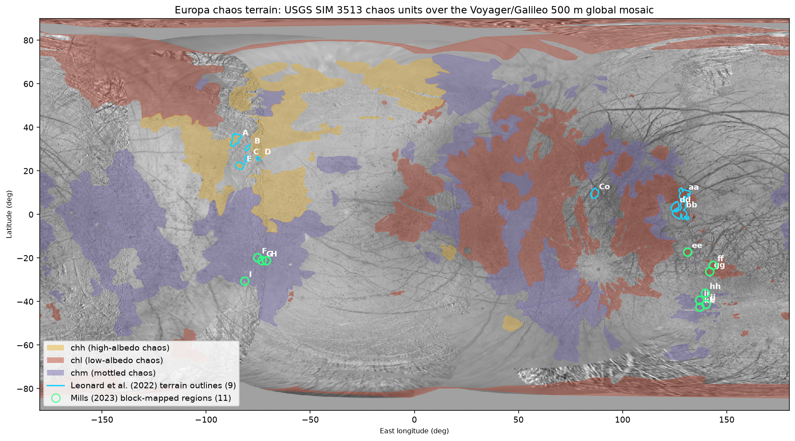
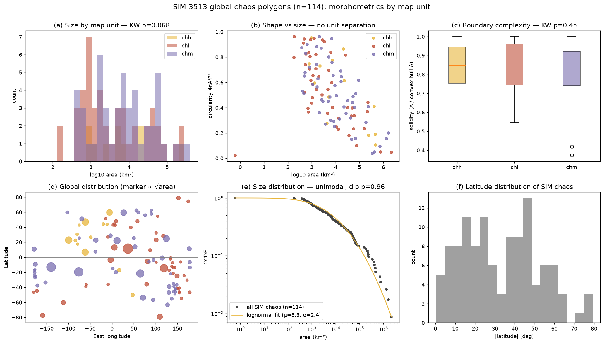
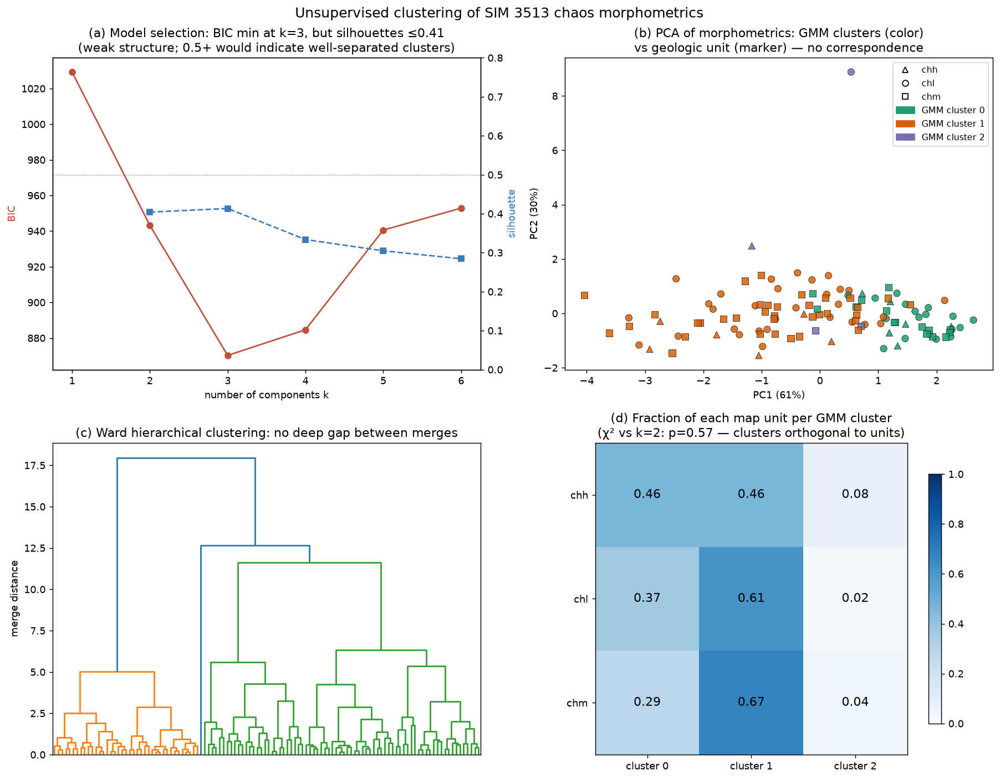
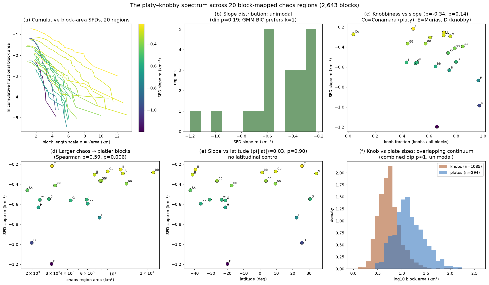
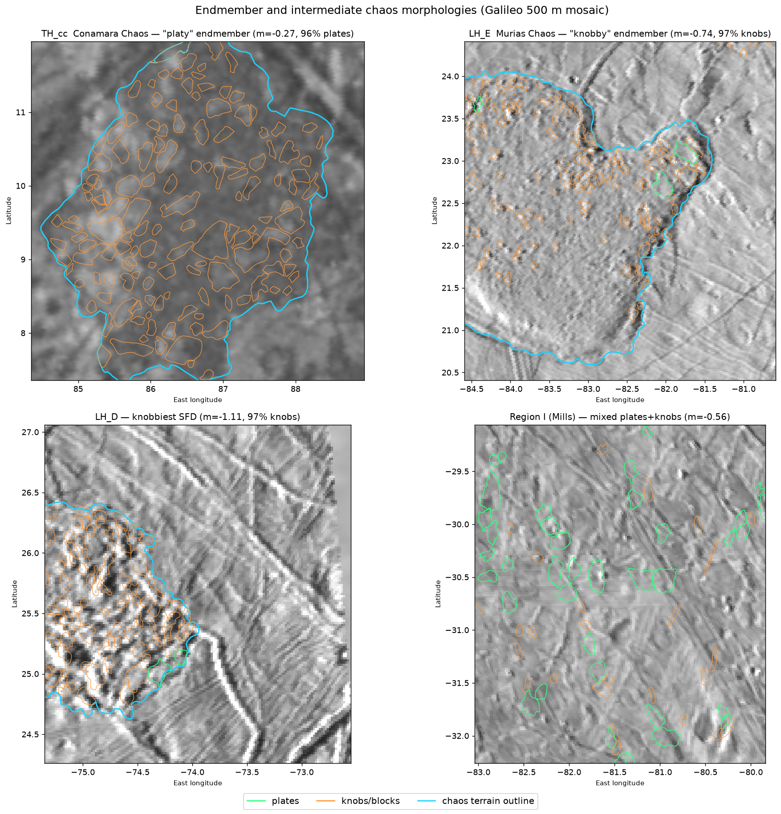
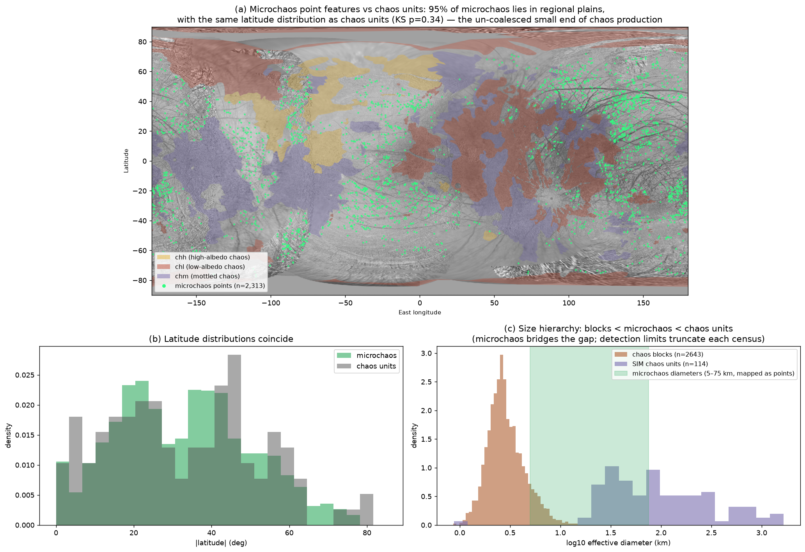

---
cursor:
  subagentId: "bc-7b8fc683-5fed-5314-917e-50b5565e397f"
---

# Is Europa's "chaos" one geologic feature type, or several lumped together?

**Quantitative morphometrics + literature synthesis** · November 2026

## The answer up front

**Mostly one family, with a small number of genuine impostors.** Every quantitative test we ran on the mapped chaos populations — 9 fully block-mapped terrains from Leonard et al. (2022), 11 more from Mills (2023) (2,643 blocks in total), and all 114 chaos polygons of the USGS global geologic map SIM 3513 — points the same way: canonical chaos terrain forms a **single continuous morphological spectrum**, not a set of discrete sub-populations.

- The platy-to-knobby block-size-distribution slope across 20 regions is **unimodal** (Hartigan dip test p = 0.19; a 1-component Gaussian mixture beats 2 by BIC), extending Leonard et al.'s 9-region continuum result to 20 regions spanning latitudes −43° to +34°.
- Block sizes form **one overlapping log-normal continuum**: the mapped "plates" and "knobs" are the large and small tails of the same distribution (combined dip p ≈ 1; a logistic classifier on size+shape reaches only 82% vs. a 73% majority baseline).
- The three chaos units of the USGS global map (high-albedo `chh`, low-albedo `chl`, mottled `chm`) are **indistinguishable in planform morphometrics** (size, circularity, solidity, elongation: Kruskal–Wallis p = 0.07–0.77). Unsupervised clustering (GMM/k-means/Ward) finds only weak structure (all silhouettes ≤ 0.41) that is **orthogonal to the map units** (χ² p = 0.57). The map's subdivision is an albedo/texture overprint that tracks hemisphere (radiation and Iogenic sulfur implantation) and maturity — not planform shape, and not, by the mappers' own description, formation mechanism.
- Chaos sizes from mapped blocks (~2 km) through microchaos (5–75 km, 2,313 point features) to giant units (>1,000 km) form a **size hierarchy with no evidence of a natural break** where a second mechanism would have to take over; microchaos shares the latitude distribution of large chaos (KS p = 0.34) and sits 95% in regional plains — consistent with being the un-coalesced small end of the same production process.

**However**, the literature and the map itself document a few features carrying the name "chaos" that are very likely **mechanistically distinct** and have been lumped in by morphological resemblance:

1. **Murias Chaos ("the Mitten", LH_E)** — elevated, with flow lobes extending tens of km over the plains. Figueredo et al. (2002) argue explicitly that it is *"distinct from typical chaos terrain"*: the surface extrusion of a rare, large thermal diapir (effectively cryovolcanic), not an in-place disruption. In our data it sits at the knobby extreme (97% knobs, SFD slope −0.74) but its *topographic* signature — not captured by planform metrics — is what sets it apart.
2. **Moytura Chaos (`chM`)** — the USGS global map gives it its own unit: smooth material standing high, broken by curvilinear depressions, found at exactly one place on Europa. The mappers themselves flag it as "a unique morphology of chaos."
3. **Candidate impact-origin chaos** — Cox et al. (2008) and Cox & Bauer (2015) show that km-scale impactors must occasionally breach the shell, and that breach sites should look like raft-filled chaos; Tyre and Callanish are transitional. If correct, *some* individual chaos patches are impact scars, though the global chaos population (40% of the surface) cannot be (the required impactor flux is orders of magnitude too high).

So the honest summary is: **"chaos" is one genetic family expressed across a continuum of size, energy, and maturity — most plausibly perched water/brine lenses and diapirism in the shell acting at different scales — plus a short list of look-alikes (dome-like extrusions, possibly a few impact breaches) that deserve separate labels.** The sub-divisions that *do* exist in current maps (chh/chl/chm; platy vs. knobby) are gradational descriptors, not mechanism classes, and our tests confirm they do not cut the population at a natural joint.

---

## 1. Data

| Dataset | Content | Source |
|---|---|---|
| Leonard et al. (2022) chaos borders | 247 digitized arc segments forming the outlines of 9 chaos terrains (LH_A–E, TH_aa–dd; TH_cc = Conamara, LH_E = Murias) | [Zenodo 12775125](https://zenodo.org/records/12775125) |
| Leonard et al. (2022) blocks | 1,910 block polygons (plates + knobs) inside the 9 terrains | same record (`AllBlocksShapefiles.zip`) |
| Mills (2023) blocks | 737 block polygons with knob/plate labels in 11 lower-RegMap regions (F–I, ee–kk) | [Zenodo 10162452](https://zenodo.org/records/10162452) |
| USGS SIM 3513 global geologic map GIS | 436 geologic unit polygons incl. 114 chaos polygons (13 `chh`, 49 `chl`, 52 `chm`/`chM`), 2,313 microchaos points, 500-m global mosaic raster | [pubs.usgs.gov/sim/3513](https://pubs.usgs.gov/sim/3513/) (Leonard, Patthoff & Senske, 2024) |
| Basemap | Voyager/Galileo SSI 500 m global mosaic (SpFill version shipped inside the SIM 3513 GIS bundle; same product as the USGS Equirectangular Mosaics of Europa v3 family) | USGS Astrogeology |
| Region metadata | plate/knob counts, areas, centers for all 20 block-mapped regions | Dunn et al. (2023, NeurIPS ML4PS), Table 3 |

All vector data are on the Europa 2000 sphere (R = 1,562.09 km).

### 1.1 Reconstructing the 9 terrain outlines

The `ChaosBorders` shapefile stores each terrain outline as 7–70 unclosed arc segments (median endpoint gap between consecutive arcs ≈ 0.01°). We verified the arcs are *terrain* outlines, not block outlines: arcs chain into terrain-sized rings (median arc span 14.7 km vs. 4.4 km for blocks), and the enclosed areas reproduce the published per-terrain areas. Reconstruction: spatial clustering of arcs (ε = 0.08°) yields exactly 9 groups; buffering each group's arc union and extracting interior holes recovers 8 of 9 terrains; TH_bb (whose outline has one 0.79° digitization gap and lobes adjacent to TH_aa) was recovered by snapping arc endpoints and polygonizing faces. Validation against Leonard et al. Table 1 / Dunn et al. Table 3 (note: the published areas use planar-equirectangular convention, i.e. no cos-latitude factor — our geodesic areas match once that convention is applied):

| Terrain | Published (km²) | Reconstructed (km²) | Δ |
|---|---|---|---|
| TH_bb | 22,570 | 22,773 | 0.9% |
| TH_aa | 13,186 | 13,259 | 0.6% |
| LH_A | 12,242 | 12,260 | 0.2% |
| TH_cc (Conamara) | 8,997 | 9,041 | 0.5% |
| TH_dd | 7,979 | 7,985 | 0.1% |
| LH_E (Murias) | 7,682 | 7,687 | 0.1% |
| LH_C | 2,945 | 2,940 | 0.2% |
| LH_B | 2,765 | 2,756 | 0.3% |
| LH_D | 1,959 | 1,958 | 0.1% |

## 2. Methods

- **Morphometrics.** Each polygon was projected to a local Lambert azimuthal equal-area frame on the Europa sphere before measurement. Per feature: geodesic area, perimeter, circularity (4πA/P²), solidity (A / convex-hull A), aspect ratio (minimum rotated rectangle), effective diameter, centroid lat/lon.
- **Block SFDs.** Following Leonard et al. (2022): for each region, ln(cumulative fractional block area above length scale x = √area) is fit linearly in x; the slope m (km⁻¹) is the platy (shallow, ≈ −0.2) to knobby (steep, ≈ −1.2) metric. Our re-derived slopes for the 9 Leonard regions match the published values to within ~0.07 km⁻¹; the same procedure was applied to the 11 Mills regions (slope is invariant to the unknown total region area, which only shifts the intercept).
- **Statistics.** Hartigan dip tests (diptest), 1D/4D Gaussian mixtures with BIC, k-means and Ward clustering with silhouettes, PCA, Kruskal–Wallis / Mann–Whitney / KS / χ² / Spearman tests (scipy, scikit-learn).
- **Cross-referencing.** Each of the 20 block-mapped regions was located in the SIM 3513 unit polygon containing its center; microchaos points were spatially joined to units.

## 3. Results

### 3.1 Global context

Chaos units cover ~40% of Europa's surface per the SIM 3513 pamphlet (our geodesic recomputation of the mapped polygons: 36.4%); `chl` dominates the anti-Jovian hemisphere, `chh` the sub-Jovian — the hemispheric pattern the mappers attribute to radiation processing and Iogenic sulfur implantation, i.e., **exogenic overprint, not formation mechanism**. The 20 block-mapped regions sit in `chl` (7), `chm` (8), `chh` (3); two (B, C) are too small to be resolved as units at 1:15,000,000 scale.

### 3.2 No planform separation among the mapped chaos units

Across the 114 global chaos polygons, none of the planform metrics differs significantly between `chh`, `chl` and `chm` (Kruskal–Wallis: log-area p = 0.068, circularity p = 0.77, solidity p = 0.45, aspect p = 0.35). The size distribution is a single log-normal-like continuum spanning 10² – 10⁶ km² (dip p = 0.96). Latitude is the only marginally distinguishing variable (p = 0.039), driven by `chh`'s concentration at northern mid-latitudes of the sub-Jovian hemisphere — again geographic, not morphological.

### 3.3 Clustering finds no natural sub-populations

A Gaussian mixture on standardized (log-area, circularity, solidity, log-aspect) prefers k = 3 by BIC, but the structure is weak — k-means silhouettes peak at 0.41 (values ≥ 0.5 would indicate genuinely separated clusters), the Ward dendrogram shows no deep gap, and the first two principal components show one elongated cloud whose dominant axis is the trivial size–shape covariance (big features have more complex outlines). Critically, the statistical clusters are **independent of the geologic map classes** (χ², p = 0.57): whatever weak structure exists, it is not the chh/chl/chm subdivision, and the subdivision is not a shape family.

### 3.4 The platy–knobby axis is a continuum, now at n = 20

Extending Leonard et al.'s SFD analysis from 9 to 20 regions (adding Mills' 11 southern-latitude regions) more than doubles the sample and breaks the original latitudinal degeneracy (regions now span −43° to +34°):

- Slopes range continuously from −0.22 (platy C) to −1.20 (knobby F); the distribution is unimodal (dip p = 0.19) and a 1-component Gaussian beats 2 components (BIC 6.3 vs 6.8). No platy cluster, no knobby cluster.
- Slope does not correlate with latitude (ρ = 0.03, p = 0.90) — Leonard et al.'s suspicion that their lat/long correlations were sampling artifacts is confirmed.
- Slope **does** correlate with region area (ρ = 0.59, p = 0.006): bigger chaos is platier. This is a scale-dependence, exactly what a single mechanism operating at different sizes/energies predicts (larger melt lenses preserve larger rafts), and hard to explain if platy and knobby chaos were different processes.
- Knob fraction correlates with slope only weakly (ρ = −0.34, p = 0.14), and **Conamara is an extreme outlier** (4% knobs; every other region has ≥ 43%). The canonical "type example" of chaos is in fact the least typical member of the mapped population — a long-standing caution (Collins & Nimmo 2009) that our numbers make vivid.
- At block level, knobs and plates overlap heavily in size and shape (panel f); the combined block-size distribution is unimodal. "Plate" vs. "knob" is a threshold on a continuum, not two populations.
- Hints worth watching, not significant at n = 20: SIM unit membership vs. knob fraction (KW p = 0.052; the three `chh` regions are the knobbiest) and leading vs. trailing hemisphere slope difference (MW p = 0.058).

### 3.5 Endmembers look different but connect continuously

Conamara (platy; rafts with preserved ridged-plains texture in a hummocky matrix) and Murias/LH_D (knobby; small rounded knobs, little preserved texture) are visually striking endmembers — but regions like I, hh, gg populate every intermediate state, and the SFD slope orders them all on one axis.

### 3.6 Microchaos: the missing small end, not a separate species

SIM 3513 separately maps 2,313 microchaos *points* (5–75 km across, ~2% of the surface) — small disruptions that would be chaos units if they were big enough to draw at map scale. They lie 95% in regional plains (by construction: coalesced ones become unit polygons) and share the latitude distribution of the chaos units (KS p = 0.34). The map's own description of `chm` invokes "incomplete coalescence and consolidation of microchaos into a broader outcrop of chaos." Together with Noviello et al. (2019) — whose discriminant analysis separates {microchaos, spots, hybrids} from {pits, domes} but cannot separate within the chaos-like supergroup — this supports a single production process whose small expressions are lenticulae-scale microchaos and whose large, coalesced expressions are regional chaos. Singer et al. (2021) find the pit/uplift/small-chaos size distribution peaks at 5–6 km with no pits < 3.3 km, which they read as diapirs or intracrustal sills (intrusion) rather than melt-through — and as a lower bound of 3–8 km on shell thickness at formation time.

## 4. Literature synthesis: mechanisms vs. the observed continuum

**Proposed mechanisms.**

| Mechanism | Key papers | Predicts | Status |
|---|---|---|---|
| Melt-through of the shell from the ocean | Carr et al. 1998; Greenberg et al. 1999; O'Brien et al. 2002 | thin (km-scale) shell; matrix = refrozen ocean; blocks = rafted lithosphere | Disfavored as the general mechanism: topography (chaos commonly stands *high*), pits/uplift morphometrics (Singer et al. 2021), and thermodynamic difficulty of localized full melt-through; but its descriptive core (blocks rafted in a liquid-derived matrix) survives inside the sill/lens models |
| Diapirism / solid-state convection | Pappalardo et al. 1998; Nimmo & Manga 2002; Pappalardo & Barr 2004 | thick shell; domed, elevated chaos; lenticulae as individual diapirs, chaos as clustered diapirs | Explains elevated/domed features and lenticula spacing; partial-melt or brine entrainment needed to make true blocky chaos |
| Brine mobilization above thermal anomalies | Head & Pappalardo 1999; Collins et al. 2000; Fagents 2003 | in-situ degradation, low-albedo halos, modest relief | A bridge between diapirism and melt lenses; favored for Thrace-type features (Matteoni et al. 2023) |
| Perched water / sill (lens) collapse | Schmidt et al. 2011; Michaut & Manga 2014; Chivers et al. 2021 | collapse + brine fluidization + refreeze doming; explains both low-standing active (Thera) and high-standing mature (Conamara) states; size set by lens size | Best current fit to the joint observations (Collins & Nimmo's constraint list); naturally produces a continuum from microchaos (small sills) to giant chaos (large lenses), with Thera Macula possibly active today |
| Impact breach | Cox et al. 2008; Cox & Bauer 2015; Billings & Kattenhorn 2003 | raft-filled breach zones; chaos+crater SFD matching an impact production function | Plausible for *individual* features; cannot produce 40% of the surface; Tyre/Callanish are the transitional cases |

**The Collins & Nimmo (2009) scorecard.** Their review set hard constraints any chaos model must meet — blocks that moved/rotated within a formerly mobile matrix, both high- and low-standing topography (Conamara's matrix stands high in places; fresh chaos often low), salt/acid exposures, a planform size range of 1–1,000 km, broad global distribution, and growth by coalescence. They concluded no single rigid model passed everything, but that melt/brine-bearing models within a relatively thick shell came closest — the direction the field then took with Schmidt et al. (2011) and Michaut & Manga (2014). Nothing in their constraint list requires two or more different mechanisms; it requires one mechanism with internal degrees of freedom (lens depth/size, melt fraction, maturity).

**The named-feature trio.** Conamara (platy; mature lens collapse with refrozen, uplifted matrix), Thera (low-standing, actively collapsing lens — Schmidt et al. 2011) and Thrace (elevated, mottled, slow diapiric/brine emplacement — Fagents 2003; Matteoni et al. 2023) are often cited as evidence for mechanism diversity. The sill/lens framework reads them more economically as *time slices and parameter variants of one process* (Thera = active; Conamara = finished; Thrace = brine-dominated, low-energy end). **Murias is the genuine exception**: Figueredo et al. (2002) showed it was elevated, extruded, and flowed tens of km — a surface-breaching mega-diapir, i.e., closer to cryovolcanism, and argued it should be "treated separately from chaos terrain." The USGS global map's unique Moytura unit (`chM`) is a second such flagged outlier.

**How SIM 3513 subdivides chaos — and what that means.** The global map splits chaos material by *relative brightness and texture*: `chl` (low-brightness, rounded blocks, matrix-rich; anti-Jovian), `chm` (mottled, mixed block/matrix; everywhere), `chh` (high-brightness, angular tens-of-km blocks; sub-Jovian), plus `chM` (Moytura, unique). The pamphlet explicitly ties the brightness classes to radiation processing, non-ice content and matrix fraction — degradational and compositional state variables — and floats microchaos coalescence as the origin of `chm` mottling. Our morphometric result (§3.2–3.3) is consistent: the units are real as *surface states* but are not planform-shape families, and nothing in our tests suggests they are mechanism classes.

**Why the Leonard/Mills block data matter.** Leonard et al. (2022) proposed that the SFD slope is a single quantitative axis that replaces the subjective platy/knobby split, and interpreted the bounded, continuous slope range as "the same principles of formation... potentially the same formation mechanism," with slope tracking the energy partitioned into fragmentation. Our 20-region extension strengthens every leg of that argument: the slope distribution stays unimodal with doubled n, the lat/long correlations they worried about evaporate, and a new scale-dependence (bigger = platier) appears that a single scalable mechanism predicts naturally.

## 5. Caveats

- **Coverage and resolution bias.** Only ~15% of Europa is imaged at ≤ 250 m/px; the 20 block-mapped regions sit in two longitude corridors (RegMap footprints). The SIM 3513 map is built on imagery from 200 m to > 1 km/px, and its unit boundaries at 1:15,000,000 scale generalize heavily. A real sub-population could hide in unimaged terrain or below resolution.
- **Small-n tests.** n = 20 regions limits power for the region-level tests (a dip test needs strong bimodality to fire at n = 20). The marginal signals (knob fraction vs. SIM unit, leading vs. trailing) are worth revisiting with Europa Clipper EIS data (> 80% coverage at < 100 m/px).
- **Planform ≠ topography.** Our morphometrics are 2-D. The features known to be genuinely distinct (Murias, Moytura) distinguish themselves mainly in *elevation* and stratigraphic relations; a topographic reanalysis (photoclinometry/stereo DEMs, or Clipper altimetry) is the natural next discriminator.
- **Outline reconstruction.** The nine Leonard outlines were reassembled from unclosed arcs (validated to ≤ 0.9% in area); residual boundary detail errors are possible but immaterial to the statistics.
- **Published-area convention.** Leonard et al./Dunn et al. region areas are planar-equirectangular (no cos-latitude correction); all areas computed in this study are geodesic on the Europa sphere. Comparisons in §1.1 account for this.

## 6. Bottom line

The question was whether "chaos" is one geologic feature type or several mistakenly merged. The quantitative answer from every dataset available in 2026 is that the **core population is one type expressed along continuous axes** — size (microchaos → Conamara-scale → giant `chm`/`chl` fields), fragmentation energy (platy → knobby), maturity (active Thera → refrozen Conamara → degraded low-albedo chaos), and exogenic surface state (chh/chl brightness classes). Treating platy vs. knobby, or high- vs. low-albedo chaos, as different *kinds* of features is not supported: they are coordinates, not categories. The mistake that *has* happened is narrower: a handful of elevated, extrusive, dome-like features (Murias, Moytura) — and possibly a few impact-breach scars — carry the "chaos" name because they look jumbled, while their formation physics is likely different. Europa Clipper's global imaging and topography should make that short list definitive.

## 7. References

- Billings, S. E. & Kattenhorn, S. A. (2003). Comparison between terrestrial explosion crater morphology in floating ice and Europan chaos. LPSC XXXIV.
- Bland, M. T. et al. (2021). Improving the usability of Galileo and Voyager images of Jupiter's moon Europa. *Earth and Space Science*, 8, e2021EA001935.
- Carr, M. H. et al. (1998). Evidence for a subsurface ocean on Europa. *Nature*, 391, 363–365.
- Chivers, C. J., Buffo, J. J., & Schmidt, B. E. (2021). Thermal and chemical evolution of small, shallow water bodies in Europa's ice shell. *JGR Planets*, 126, e2020JE006692.
- Collins, G. C., Head, J. W., Pappalardo, R. T., & Spaun, N. A. (2000). Evaluation of models for the formation of chaotic terrain on Europa. *JGR Planets*, 105, 1709–1716.
- Collins, G. & Nimmo, F. (2009). Chaotic terrain on Europa. In *Europa* (Univ. Arizona Press), 259–282.
- Cox, R., Ong, L. C. F., Arakawa, M., & Scheider, K. C. (2008). Impact penetration of Europa's ice crust as a mechanism for formation of chaos terrain. *Meteoritics & Planetary Science*, 43, 2027–2048.
- Cox, R. & Bauer, A. W. (2015). Impact breaching of Europa's ice: Constraints from numerical modeling. *JGR Planets*, 120, 1708–1719.
- Culha, C. & Manga, M. (2016). Geometry and spatial distribution of lenticulae on Europa. *Icarus*, 271, 49–56.
- Dunn, M. M., Mills, A. C., et al. (2023). Detection and segmentation of ice blocks in Europa's chaos terrain using Mask R-CNN. *Machine Learning and the Physical Sciences Workshop, NeurIPS 2023*.
- Fagents, S. A. (2003). Considerations for effusive cryovolcanism on Europa: The post-Galileo perspective. *JGR Planets*, 108, 5139.
- Figueredo, P. H., Chuang, F. C., Rathbun, J., Kirk, R. L., & Greeley, R. (2002). Geology and origin of Europa's "Mitten" feature (Murias Chaos). *JGR Planets*, 107, 5026.
- Greeley, R. et al. (2000). Geologic mapping of Europa. *JGR Planets*, 105, 22559–22578.
- Greenberg, R. et al. (1999). Chaos on Europa. *Icarus*, 141, 263–286.
- Head, J. W. & Pappalardo, R. T. (1999). Brine mobilization during lithospheric heating on Europa. *JGR Planets*, 104, 27143–27155.
- Leonard, E. J., Howell, S. M., Mills, A., Senske, D. A., Patthoff, D. A., Hay, H. C. F. C., & Pappalardo, R. T. (2022). Finding order in chaos: Quantitative predictors of chaos terrain morphology on Europa. *GRL*, 49, e2021GL097309. Data: doi:10.5281/zenodo.6338798 (v2: 12775125).
- Leonard, E. J., Patthoff, D. A., & Senske, D. A. (2024). Global geologic map of Europa. *USGS SIM 3513*, 1:15,000,000.
- Matteoni, P. et al. (2023). Evolution of Thrace Macula on Europa: Strike-slip tectonic control and identification of the youngest terrains. *JGR Planets*, 128, e2023JE007883.
- Mével, L. & Mercier, E. (2007). Large-scale doming on Europa: A model of formation of Thera Macula. *Planetary and Space Science*, 55, 915–927.
- Michaut, C. & Manga, M. (2014). Domes, pits, and small chaos on Europa produced by water sills. *JGR Planets*, 119, 550–573.
- Mills, A. C. (2023). Europa chaos block shapefiles and GeoJSON files in lower RegMap images. doi:10.5281/zenodo.10162452.
- Nimmo, F. & Manga, M. (2002). Causes, characteristics and consequences of convective diapirism on Europa. *GRL*, 29, 2109.
- Noviello, J. L., Torrano, Z. A., Rhoden, A. R., & Singer, K. N. (2019). Mapping Europa's microfeatures in regional mosaics: New constraints on formation models. *Icarus*, 329, 101–123.
- O'Brien, D. P., Geissler, P., & Greenberg, R. (2002). A melt-through model for chaos formation on Europa. *Icarus*, 156, 152–161.
- Pappalardo, R. T. et al. (1998). Geological evidence for solid-state convection in Europa's ice shell. *Nature*, 391, 365–368.
- Pappalardo, R. T. & Barr, A. C. (2004). The origin of domes on Europa: The role of thermally induced compositional diapirism. *GRL*, 31, L01701.
- Schmidt, B. E., Blankenship, D. D., Patterson, G. W., & Schenk, P. M. (2011). Active formation of 'chaos terrain' over shallow subsurface water on Europa. *Nature*, 479, 502–505.
- Singer, K. N., McKinnon, W. B., & Schenk, P. M. (2021). Pits, uplifts and small chaos features on Europa: Morphologic and morphometric evidence for intrusive upwelling and lower limits to ice shell thickness. *Icarus*, 364, 114465.
- Spaun, N. A., Head, J. W., Collins, G. C., Prockter, L. M., & Pappalardo, R. T. (1998). Conamara Chaos region, Europa: Reconstruction of mobile polygonal ice blocks. *GRL*, 25, 4277–4280.

## Appendix: figure and data inventory

Figures (all verified present):

- `../figures/fig1-global-chaos-map.png`
- `../figures/fig2-sim3513-morphometrics.png`
- `../figures/fig3-clustering.png`
- `../figures/fig4-platy-knobby-continuum.png`
- `../figures/fig5-endmember-closeups.png`
- `../figures/fig6-microchaos.png`

Working data (VM, `/tmp/europa/work/`): `chaos9_final.geojson` (reconstructed terrain outlines), `sim_morpho.csv` / `sim_morpho_clustered.csv` (114 SIM chaos morphometrics), `blocks_all.csv` (2,643 blocks), `regions20_full.csv` (per-region SFD slopes, knob fractions, SIM-unit cross-reference), `microchaos.geojson` (2,313 points with host units), `stats_results.txt` / `stats_results2.txt` (test logs).
