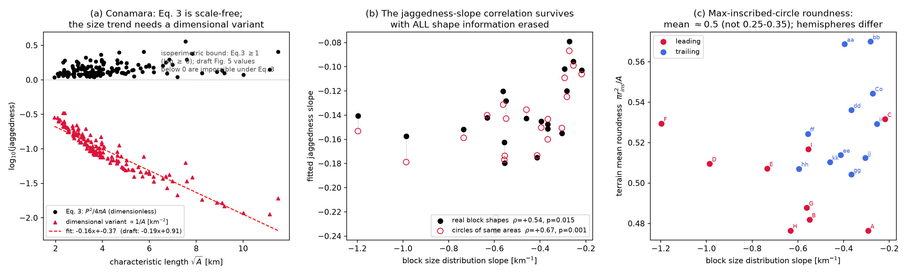

---
cursor:
  subagentId: "bc-7b8fc683-5fed-5314-917e-50b5565e397f"
---

# Review of Mills et al. (draft): "Quantifying Chaos Block Morphology on Europa: Constraints on Chaos Evolution"

Independent check of the analysis, results, and conclusions, performed against
the public block datasets (Leonard et al. 2022, Zenodo 12775125; Mills 2023,
Zenodo 10162452; 2,665 unique blocks re-measured across the same 20 regions
A–I, aa–kk, Co — note the Mills GeoJSON release stores an all-blocks file plus
an overlapping plate-subset file per region, which must be deduplicated). Verification figure:
. Analysis scripts:
`check_mills*.py` and `check_fig.py` in this directory.

## 1. Digest of the draft

**Question.** If knobby chaos is the evolved, more-fragmented end state of
platy chaos (per Leonard et al. 2022's continuum interpretation), do block
shapes record that evolution? Prediction: knobbier terrains (steeper block
size-frequency-distribution slopes) should have rounder, less angular blocks.

**Data.** Manually digitized chaos blocks from ~250 m/px Galileo RegMap
imagery: the L22 nine terrains plus Mills' additional terrains (20 regions
total, 9 leading / 11 trailing hemisphere; ~2,044 blocks per the Hotelling
degrees of freedom).

**Metrics.** Per block: (1) roundness = area of maximum inscribed circle over
block area (after Janoo 1998); (2) degree of angularity
A = (180° − α)(x/r), α = sin⁻¹(r/x), with r the inscribed-circle radius and
x the distance to the farthest vertex (after Lees 1964); (3) "jaggedness"
J = P²/4πA (Eq. 3).

**Reported results.** (i) Terrain-average roundness (≈0.25–0.35) and
angularity (≈450–710) show no significant Spearman correlation with SFD slope
(all-chaos ρ = −0.009 and +0.238). (ii) Jaggedness correlates strongly with
block size within terrains; the per-terrain "jaggedness slope" (fit of
log jaggedness vs. block length) correlates with SFD slope (all-chaos
ρ = 0.444, p = 0.052; leading hemisphere ρ = 0.833, p = 0.008), and
terrain-mean jaggedness does too (ρ = −0.546, p = 0.014). (iii) Hemispheres
differ: trailing blocks rounder (0.331 vs 0.278), leading blocks more jagged
and angular; Hotelling's T² on five block-level variables is highly
significant (T² = 121.4, p < 0.001).

**Conclusions.** Roundness and angularity are not reliable indicators of
chaos evolution; the platy→knobby transition is not a simple progression
toward rounder blocks; jaggedness scaling may carry fragmentation
information; hemispheres differ morphologically. These are appropriately
hedged in the discussion.

## 2. What reproduces

- **The null results for roundness and angularity vs. SFD slope are
  confirmed** once the hemisphere confound is controlled. In my re-measurement
  the pooled terrain-mean roundness shows at most a marginal correlation with
  SFD slope (ρ = +0.40, p = 0.08), and a regression of terrain roundness on
  SFD slope + hemisphere shows the slope term is null (p = 0.81) while the
  hemisphere term is significant (p = 0.031): the apparent correlation is the hemisphere
  difference in disguise. The draft's core negative conclusion — block shape
  does not track the platy→knobby axis — stands, and is arguably stronger
  than the draft states (see §4, M5).
- **The hemisphere difference replicates.** Block-level Hotelling's T² on my
  independently re-measured five variables gives T² = 160, F = 32 (draft:
  T² = 121.4, F = 24.2) — remarkably close. Direction agrees: trailing blocks
  rounder (my means 0.545 vs 0.496; draft 0.331 vs 0.278), leading blocks more
  angular. Crucially, the trailing-rounder difference survives an honest
  terrain-level Mann-Whitney test (p = 0.023, n = 9 vs 11) — this is the
  paper's most defensible positive result (but see M4 on the T² itself).
- **Angularity values are in the right range** (my terrain means span a
  comparable range to the draft's 445–711; medians and the long upper tail they describe
  both reproduce). Differences are consistent with their expanded block set.
- **Fisher r-to-z arithmetic checks out** (e.g., their z = 2.648 for the
  jaggedness-slope hemisphere contrast is what the standard formula gives for
  ρ = 0.833 vs −0.227 with n = 9, 11).

## 3. What does not reproduce

- **Jaggedness as defined (Eq. 3) cannot produce the reported numbers.**
  J = P²/4πA is dimensionless and scale-invariant, with an isoperimetric
  lower bound of 1 (log₁₀ J ≥ 0). Yet the text says J "has units of inverse
  length," Fig. 5's y-axis is labeled −log(km) with most Conamara values
  *below* 0 (impossible under Eq. 3), and the reported hemisphere means
  (~1,414–1,570) are three orders of magnitude above anything Eq. 3 can give
  for real blocks (my measured range: 1.01–5.7, mean 1.63). Empirically,
  whatever was computed scales ≈ 1/A (my fit of the 1/A-type variant on
  Conamara gives slope −0.16 vs. their −0.19; Eq. 3 proper gives +0.015,
  i.e. flat). Either Eq. 3 or the computation is wrong, and the text,
  equation, figure, and tabulated values are mutually inconsistent.
- **Roundness scale.** With the stated definition (max-inscribed-circle area
  / block area) I obtain terrain means of 0.48–0.57, not 0.25–0.35. The
  alternative reading (inscribed vs. circumscribed circle area, (r/x)²) gives
  0.17–0.26 — also not matching. Relative ordering partially agrees (aa, bb,
  Co highest; A, B lowest in both), so the correlations may be robust, but
  the absolute scale as published is not reproducible from the stated
  formula; the computation should be documented (and released) exactly.

## 4. Major issues

**M1 — The jaggedness results are artifacts of the size distribution, not
block morphology.** This is the central problem. Because the computed
jaggedness varies as ≈ 1/A, both of the "significant" jaggedness findings are
nearly guaranteed by construction, independent of block shape:

- *Circle-null test:* I replaced every block with a perfect circle of the
  same area (all shape information erased) and re-ran their pipeline
  (per-terrain linear fit of log jaggedness vs. √A, then Spearman vs. SFD
  slope). The correlation not only persists — it strengthens: real shapes
  ρ = +0.54 (p = 0.015); circles ρ = +0.67 (p = 0.001). Per hemisphere:
  leading real +0.60 / circles +0.68; trailing real +0.76 / circles +0.81.
- *Mechanism:* fitting a line to log(1/L²) vs. L gives a slope controlled by
  the terrain's mean block size (null jaggedness slope vs. 1/mean L:
  ρ = −0.54, p = 0.013), and the SFD slope is likewise a size-distribution
  summary (SFD slope vs. mean L: ρ = +0.56, p = 0.010). The two axes of
  their correlation are the same quantity measured twice.

The draft's §4.3 caveats gesture at this ("differences in jaggedness slope
should be interpreted as differences in the observed scaling relationship"),
but §4.4–4.5 and the Conclusions still treat the correlation as potentially
informative about fragmentation. It is not: unless a terrain's jaggedness
slope differs from its own size-distribution-matched null, it contains zero
morphological information. Recommend either dropping the jaggedness-slope
correlation or re-casting it against the circle null (report the *residual*
from the null, which my run suggests is indistinguishable from noise).

**M2 — Eq. 3 / units / Fig. 5 / tabulated means are mutually inconsistent**
(detail in §3). At minimum the actual computed formula and units must be
stated; all downstream numbers re-derived; and if the intended metric really
is P²/4πA, the entire jaggedness section changes qualitatively (the true
Eq. 3 metric shows *no* size trend within Conamara, slope +0.015).

**M3 — "Significant" vs. the table.** The text (§4.3, Conclusions) calls the
all-chaos jaggedness-slope correlation significant, but Table 1 reports
p = 0.052, which fails the paper's own α = 0.05 threshold. The only
significant all-chaos entries are mean jaggedness (p = 0.014, artifact per
M1) and the Fisher contrast. Wording must match the table.

**M4 — Pseudoreplication in the Hotelling test.** T² treats ~2,044 blocks as
independent samples, but blocks are clustered within 20 terrains that differ
in mapper, image geometry, and incidence angle; effective n is closer to 20
than 2,000. The result survives a terrain-level test for roundness
(p ≈ 0.02), so the conclusion is salvageable, but the inference should be
hierarchical (e.g., mixed model with terrain random effect, or terrain-level
tests). The PCA panel shows the two hemisphere clouds almost fully
overlapping — "significant" here means a small mean shift detected with huge
n, and should be characterized by effect size, not p-value.

**M5 — The hemisphere/knobbiness confound cuts the other way, favorably.**
Leading-hemisphere terrains are systematically knobbier (D, E, F, H), so
hemisphere and SFD slope are collinear. My regression (terrain roundness ~
SFD slope + hemisphere) attributes the roundness signal to *hemisphere*
(p = 0.031), not slope (p = 0.81). The draft could make this explicit — it
simultaneously strengthens the "no evolution signal" conclusion and the
hemispheric-difference finding, which is a cleaner story than presenting the
two results separately.

## 5. Minor issues

1. §3.1 contains incomplete sentences and placeholder fragments: "We find no
   statistically significant relationship where.", "(l)", "...as evident with
   the Spearman test ()". Key Points, Abstract, Plain Language Summary, Open
   Research, and the References list are still template text; several dozen
   in-text citations are absent from the reference list.
2. §3.1 states trailing terrains "cluster within approximately 0.30–0.34,"
   but Fig. 3 shows dd at ≈0.254.
3. Angularity "ranges from approximately 450 to 700": Fig. 4 shows 445–711;
   fine, but the superscript degree-like formatting ("450"/"700" rendered
   from 45⁰/70⁰?) should be checked, and the Lees metric's units (degrees ×
   dimensionless ratio) stated.
4. PCA: including log area, log perimeter, AND jaggedness (a deterministic
   function of the first two under the computed variant, r = −0.925) makes
   PC1 and the "97% of variance in 3 PCs" result partly circular. Consider
   PCA on shape variables only (roundness, angularity, scale-corrected edge
   complexity).
5. Fisher r-to-z on Spearman coefficients should use the Spearman-adjusted
   standard error (≈1.06/(n−3)) rather than the Pearson 1/(n−3); with n = 9
   and 11 the contrast p-values are anti-conservative.
6. With n = 9 and 11 terrains, the per-hemisphere Spearman tests are badly
   underpowered; the leading-hemisphere ρ = 0.833 (n = 9) should carry a
   confidence interval (roughly 0.4–0.96) to avoid over-reading.
7. Roundness depends on block pixel footprint at 250 m/px (small blocks are
   few-vertex polygons). A roundness-vs-size diagnostic would strengthen the
   null claims; in my re-measurement roundness is uncorrelated with block
   length (ρ = −0.02), which is reassuring and worth reporting.
8. The Mills 2023 Zenodo GeoJSONs contain a handful of degenerate sliver
   polygons (features with lengths of 1–100 m in regions I and hh) that
   explode the angularity and jaggedness tails; worth filtering/flagging in
   the released data. Separately, each region ships an all-blocks file
   (`Chaos_X.json`) plus a plate-subset file (`Chaos_X_plates.json`) whose
   features duplicate geometries in the first — concatenating them double
   counts every plate, so the release README should state the structure. The dataset DOIs (10.5281/zenodo.6338798 /12775125,
   10.5281/zenodo.10162452, plus the new mappings) belong in Open Research.
9. Typos: "its' ice shell" (§1), "trialing hemispheres" (§4.5), "a newer
   imagery" (§4.2), "roundness blocks" (Conclusions ¶1), Fig. 1 caption
   credit duplication.

## 6. Bottom line

The paper's negative conclusions — roundness and angularity do not track the
platy→knobby axis, so the transition is not a simple fragmentation-rounding
progression — are confirmed independently and are publishable, as is the
hemispheric asymmetry in block roundness (which survives honest terrain-level
statistics and is consistent with my earlier 20-region analysis, where the
hemisphere difference in SFD slope was marginal at p = 0.058). The jaggedness
analysis, however, needs to be reworked before submission: the metric's
definition, units, figure, and tabulated values are mutually inconsistent,
and both "significant" jaggedness correlations are reproduced in full by
shape-free circles matched to the block areas — they restate the block size
distribution and cannot constrain fragmentation or modification. Recasting
the jaggedness section around a size-matched null (and moving the hemisphere
result onto hierarchical statistics) would leave a clean, internally
consistent manuscript.
